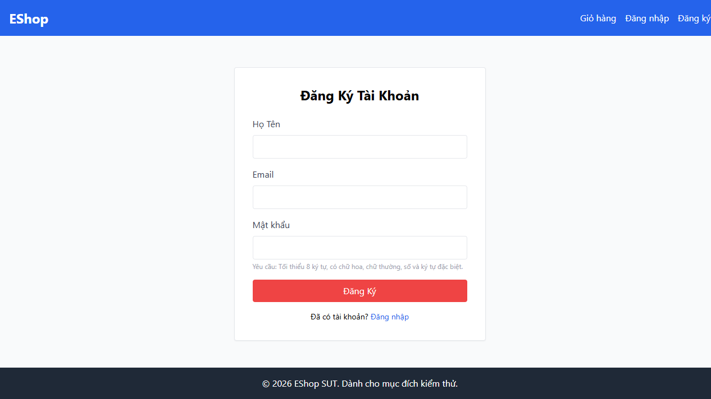
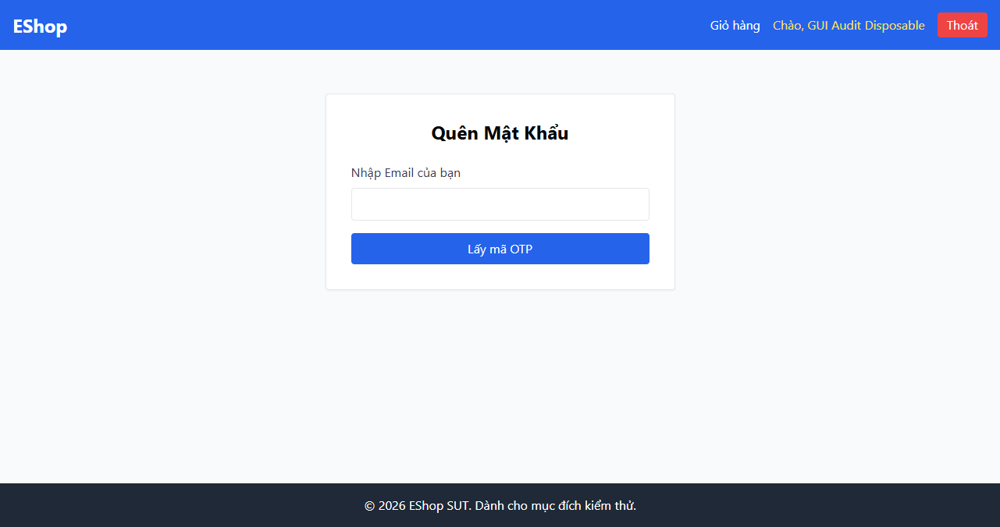
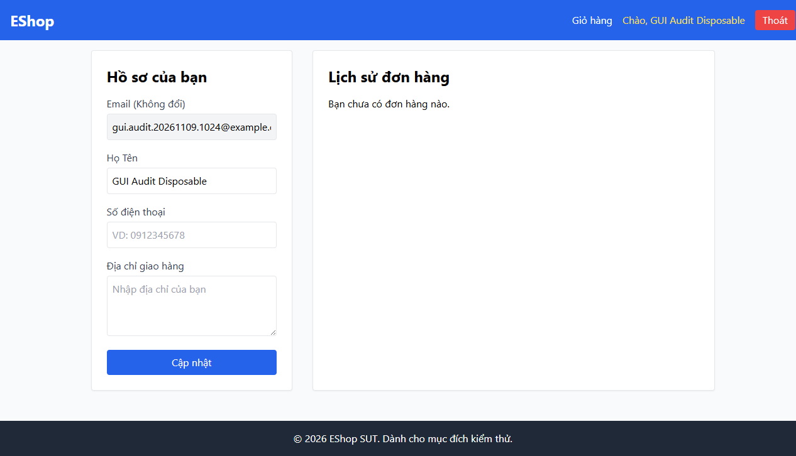

Đã được người dùng duyệt để tạo Issue từ mục 1 trong `04-bug-reports.md`.

- **Checklist ID:** GUI-001, GUI-036, GUI-052
- **Màn hình / URL SUT:** `http://127.0.0.1:5173/register`, `/forgot-password`, `/profile`
- **Severity:** Thấp — cả ba màn hình đều thiếu cấu trúc tiêu đề cấp trang theo yêu cầu, làm giảm độ rõ ràng của cấu trúc trang và điều hướng bằng heading.

### Environment
**Môi trường ghi nhận quan sát trong checklist:** trình duyệt tích hợp VS Code (Electron 43.8.3; Chrome 150.0.7871.250), Windows NT 10.0, khung nhìn 1281 × 676. Checklist ghi khoảng thời gian thực thi là 2026-11-09 10:21–10:35 +07, không ghi thời điểm riêng cho từng mục. GUI-044 và GUI-059 có thêm ảnh mới do người dùng cung cấp; không chạy lại kiểm thử khi cập nhật báo cáo.

### Preconditions
Mở từng màn hình được liệt kê; cần người dùng đã đăng nhập để vào Hồ sơ.

### Steps
1. Mở `/register`, `/forgot-password` hoặc `/profile` sau khi đăng nhập.
2. Kiểm tra tiêu đề hiển thị và cấp heading của trang.

### Expected
Mỗi trang có đúng một tiêu đề H1 mô tả trang, theo yêu cầu GUI FR-21.

### Actual
Checklist ghi nhận tiêu đề Đăng ký và Quên mật khẩu là H2; Hồ sơ có hai tiêu đề phần H2 và không có H1.

### Reproducibility / Giới hạn xác minh
Không kiểm tra lại trong giai đoạn báo cáo; xem bằng chứng thực thi được liên kết.

### Notes
Báo cáo gộp tình trạng thiếu H1 giống nhau ở ba màn hình. Màn hình Đăng nhập được ghi riêng vì tiêu đề còn ghi sai tên trang.

### Screenshots
[GUI-001](https://github.com/vinhuytran0810-cell/HW03-GUI-Usability/blob/7fe3c58385a9d30107f323e39a2a0d67e4b6a0ba/evidence/gui/GUI-001-registration-heading.png?raw=true), [GUI-036](https://github.com/vinhuytran0810-cell/HW03-GUI-Usability/blob/7fe3c58385a9d30107f323e39a2a0d67e4b6a0ba/evidence/gui/GUI-036-forgot-heading.png?raw=true), [GUI-052](https://github.com/vinhuytran0810-cell/HW03-GUI-Usability/blob/7fe3c58385a9d30107f323e39a2a0d67e4b6a0ba/evidence/gui/GUI-052-profile-heading.png?raw=true)

[GUI-001 — mở screenshot](https://github.com/vinhuytran0810-cell/HW03-GUI-Usability/blob/7fe3c58385a9d30107f323e39a2a0d67e4b6a0ba/evidence/gui/GUI-001-registration-heading.png?raw=true)

[GUI-036 — mở screenshot](https://github.com/vinhuytran0810-cell/HW03-GUI-Usability/blob/7fe3c58385a9d30107f323e39a2a0d67e4b6a0ba/evidence/gui/GUI-036-forgot-heading.png?raw=true)

[GUI-052 — mở screenshot](https://github.com/vinhuytran0810-cell/HW03-GUI-Usability/blob/7fe3c58385a9d30107f323e39a2a0d67e4b6a0ba/evidence/gui/GUI-052-profile-heading.png?raw=true)

<!-- approved-gui-report:1; checklist:GUI-001, GUI-036, GUI-052 -->
