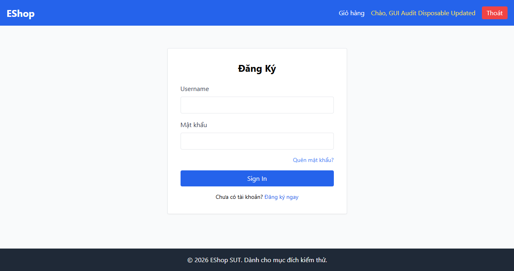

Đã được người dùng duyệt để tạo Issue từ mục 2 trong `04-bug-reports.md`.

- **Checklist ID:** GUI-020, GUI-023
- **Màn hình / URL SUT:** `http://127.0.0.1:5173/login` (cũng có thể truy cập từ màn hình Đăng ký)
- **Severity:** Trung bình — tiêu đề trang đích xác định sai màn hình hiện tại.

### Environment
**Môi trường ghi nhận quan sát trong checklist:** trình duyệt tích hợp VS Code (Electron 43.8.3; Chrome 150.0.7871.250), Windows NT 10.0, khung nhìn 1281 × 676. Checklist ghi khoảng thời gian thực thi là 2026-11-09 10:21–10:35 +07, không ghi thời điểm riêng cho từng mục. GUI-044 và GUI-059 có thêm ảnh mới do người dùng cung cấp; không chạy lại kiểm thử khi cập nhật báo cáo.

### Preconditions
Mở màn hình Đăng ký.

### Steps
1. Kích hoạt liên kết “Đăng nhập” trong biểu mẫu.
2. Kiểm tra tiêu đề trang đích tại `/login`.

### Expected
Màn hình Đăng nhập mở ra với tiêu đề xác định đúng trang Đăng nhập.

### Actual
Đường dẫn mở `/login`, nhưng tiêu đề là “Đăng Ký” và được hiển thị ở cấp H2.

### Reproducibility / Giới hạn xác minh
Không kiểm tra lại trong giai đoạn báo cáo; xem bằng chứng thực thi được liên kết.

### Notes
Phát hiện 1 cũng đề cập việc thiếu H1; phát hiện này tập trung vào tiêu đề trang Đăng nhập bị sai.

### Screenshots
[GUI-020](https://github.com/vinhuytran0810-cell/HW03-GUI-Usability/blob/7fe3c58385a9d30107f323e39a2a0d67e4b6a0ba/evidence/gui/GUI-020-registration-link-destination-heading.png?raw=true), [GUI-023](https://github.com/vinhuytran0810-cell/HW03-GUI-Usability/blob/7fe3c58385a9d30107f323e39a2a0d67e4b6a0ba/evidence/gui/GUI-023-login-heading.png?raw=true)

[GUI-020 — mở screenshot](https://github.com/vinhuytran0810-cell/HW03-GUI-Usability/blob/7fe3c58385a9d30107f323e39a2a0d67e4b6a0ba/evidence/gui/GUI-020-registration-link-destination-heading.png?raw=true)

[GUI-023 — mở screenshot](https://github.com/vinhuytran0810-cell/HW03-GUI-Usability/blob/7fe3c58385a9d30107f323e39a2a0d67e4b6a0ba/evidence/gui/GUI-023-login-heading.png?raw=true)

<!-- approved-gui-report:2; checklist:GUI-020, GUI-023 -->
