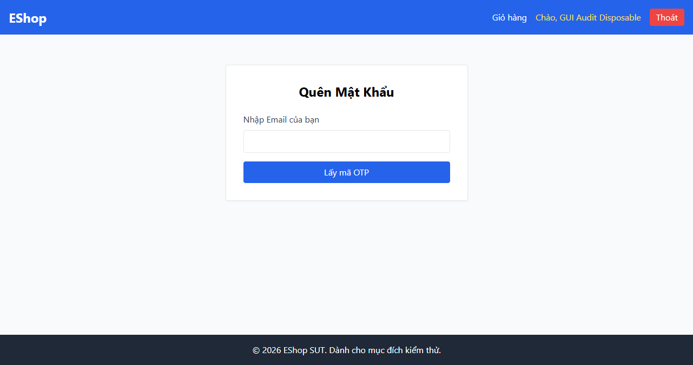

Đã được người dùng duyệt để tạo Issue từ mục 3 trong `04-bug-reports.md`.

- **Checklist ID:** GUI-006, GUI-026, GUI-039
- **Màn hình / URL SUT:** `http://127.0.0.1:5173/register`, `/login`, `/forgot-password`
- **Severity:** Trung bình — các trường không dùng kiểu nhập email/khả năng xác thực HTML như tài liệu yêu cầu.

### Environment
**Môi trường ghi nhận quan sát trong checklist:** trình duyệt tích hợp VS Code (Electron 43.8.3; Chrome 150.0.7871.250), Windows NT 10.0, khung nhìn 1281 × 676. Checklist ghi khoảng thời gian thực thi là 2026-11-09 10:21–10:35 +07, không ghi thời điểm riêng cho từng mục. GUI-044 và GUI-059 có thêm ảnh mới do người dùng cung cấp; không chạy lại kiểm thử khi cập nhật báo cáo.

### Preconditions
Mở các màn hình Đăng ký, Đăng nhập và Quên mật khẩu.

### Steps
1. Kiểm tra trường email tại `/register`.
2. Kiểm tra trường email tại `/login`.
3. Kiểm tra trường email khôi phục tại `/forgot-password`.

### Expected
Mỗi trường email được khai báo `type=email`, theo FR-22.

### Actual
Cả ba trường đều được khai báo `type=text`.

### Reproducibility / Giới hạn xác minh
Không kiểm tra lại trong giai đoạn báo cáo; xem bằng chứng thực thi được liên kết.

### Notes
Quyết định review: chỉ gộp vấn đề `type="text"` của GUI-026 vào phát hiện này. Không tạo bug độc lập cho nhãn “Username”; GUI-026 vẫn được giữ nguyên trong checklist.

### Screenshots
[GUI-006](https://github.com/vinhuytran0810-cell/HW03-GUI-Usability/blob/7fe3c58385a9d30107f323e39a2a0d67e4b6a0ba/evidence/gui/GUI-006-registration-email-type.png?raw=true), [GUI-026](https://github.com/vinhuytran0810-cell/HW03-GUI-Usability/blob/7fe3c58385a9d30107f323e39a2a0d67e4b6a0ba/evidence/gui/GUI-026-login-email-type-label.png?raw=true), [GUI-039](https://github.com/vinhuytran0810-cell/HW03-GUI-Usability/blob/7fe3c58385a9d30107f323e39a2a0d67e4b6a0ba/evidence/gui/GUI-039-forgot-email-type.png?raw=true)

[GUI-006 — mở screenshot](https://github.com/vinhuytran0810-cell/HW03-GUI-Usability/blob/7fe3c58385a9d30107f323e39a2a0d67e4b6a0ba/evidence/gui/GUI-006-registration-email-type.png?raw=true)

[GUI-026 — mở screenshot](https://github.com/vinhuytran0810-cell/HW03-GUI-Usability/blob/7fe3c58385a9d30107f323e39a2a0d67e4b6a0ba/evidence/gui/GUI-026-login-email-type-label.png?raw=true)

[GUI-039 — mở screenshot](https://github.com/vinhuytran0810-cell/HW03-GUI-Usability/blob/7fe3c58385a9d30107f323e39a2a0d67e4b6a0ba/evidence/gui/GUI-039-forgot-email-type.png?raw=true)

<!-- approved-gui-report:3; checklist:GUI-006, GUI-026, GUI-039 -->
