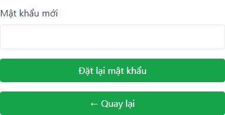

Đã được người dùng duyệt để tạo Issue từ mục 5 trong `04-bug-reports.md`.

- **Checklist ID:** GUI-047
- **Màn hình / URL SUT:** `http://127.0.0.1:5173/forgot-password` (bước đặt lại mật khẩu)
- **Severity:** Trung bình — biểu mẫu đặt lại thiếu điều khiển xác nhận theo yêu cầu FR-03.

### Environment
**Môi trường ghi nhận quan sát trong checklist:** trình duyệt tích hợp VS Code (Electron 43.8.3; Chrome 150.0.7871.250), Windows NT 10.0, khung nhìn 1281 × 676. Checklist ghi khoảng thời gian thực thi là 2026-11-09 10:21–10:35 +07, không ghi thời điểm riêng cho từng mục. GUI-044 và GUI-059 có thêm ảnh mới do người dùng cung cấp; không chạy lại kiểm thử khi cập nhật báo cáo.

### Preconditions
Luồng khôi phục đã đến bước đặt lại mật khẩu.

### Steps
1. Kiểm tra các trường trong biểu mẫu ở bước đặt lại.
2. Tìm trường nhập xác nhận mật khẩu riêng.

### Expected
Có cả trường mật khẩu mới và xác nhận mật khẩu; cả hai đều che ký tự đã nhập.

### Actual
Checklist ghi nhận trường OTP và mật khẩu mới nhưng không có trường xác nhận mật khẩu.

### Reproducibility / Giới hạn xác minh
Không kiểm tra lại trong giai đoạn báo cáo; xem bằng chứng thực thi được liên kết.

### Notes
Vấn đề này khác với trường xác nhận mật khẩu bị thiếu ở màn hình Đăng ký.

### Screenshots
[GUI-047 crop đã che](https://github.com/vinhuytran0810-cell/HW03-GUI-Usability/blob/7fe3c58385a9d30107f323e39a2a0d67e4b6a0ba/evidence/gui/report-redacted/GUI-047-confirm-missing-redacted.png?raw=true) — bản crop đã loại phần OTP hiển thị trong ảnh gốc.

[GUI-047 crop đã che — mở screenshot](https://github.com/vinhuytran0810-cell/HW03-GUI-Usability/blob/7fe3c58385a9d30107f323e39a2a0d67e4b6a0ba/evidence/gui/report-redacted/GUI-047-confirm-missing-redacted.png?raw=true)

<!-- approved-gui-report:5; checklist:GUI-047 -->
