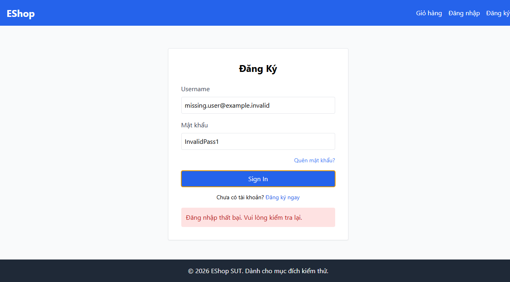
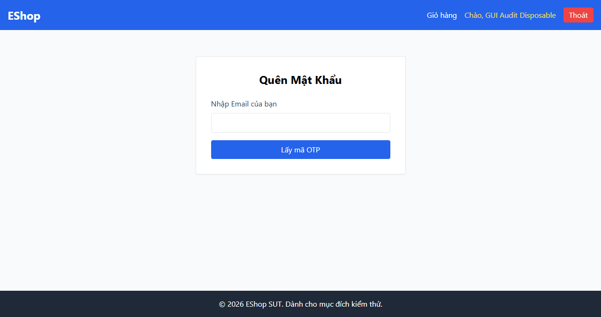
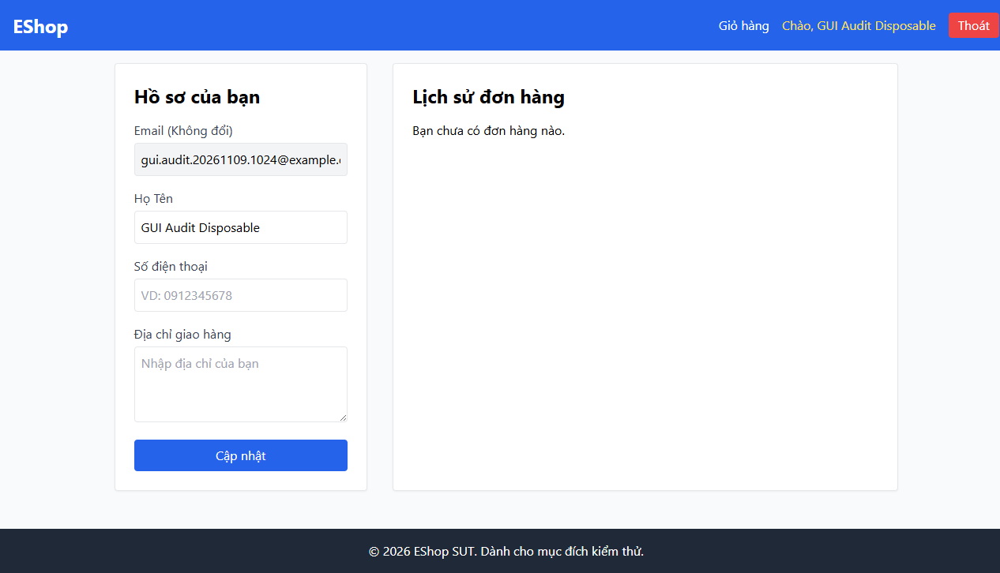

Đã được người dùng duyệt để tạo Issue từ mục 6 trong `04-bug-reports.md`.

- **Checklist ID:** GUI-009, GUI-028, GUI-040, GUI-048, GUI-058
- **Màn hình / URL SUT:** Đăng ký, Đăng nhập, Quên mật khẩu, Hồ sơ
- **Severity:** Thấp — các trường bắt buộc không được đánh dấu trực quan như yêu cầu FR-22.

### Environment
**Môi trường ghi nhận quan sát trong checklist:** trình duyệt tích hợp VS Code (Electron 43.8.3; Chrome 150.0.7871.250), Windows NT 10.0, khung nhìn 1281 × 676. Checklist ghi khoảng thời gian thực thi là 2026-11-09 10:21–10:35 +07, không ghi thời điểm riêng cho từng mục. GUI-044 và GUI-059 có thêm ảnh mới do người dùng cung cấp; không chạy lại kiểm thử khi cập nhật báo cáo.

### Preconditions
Mở từng màn hình; mục GUI-048 của Quên mật khẩu cần ở bước đặt lại.

### Steps
1. Kiểm tra nhãn các trường được quy định là bắt buộc trên từng biểu mẫu.
2. Kiểm tra dấu hoa thị bắt buộc bên cạnh từng nhãn tương ứng.

### Expected
Các trường bắt buộc có dấu hoa thị hiển thị bên cạnh nhãn, theo FR-22.

### Actual
Checklist ghi nhận không có dấu hoa thị ở Đăng ký, Đăng nhập, cả hai bước khôi phục hoặc trường Họ tên bắt buộc trong Hồ sơ.

### Reproducibility / Giới hạn xác minh
Không kiểm tra lại trong giai đoạn báo cáo; xem bằng chứng thực thi được liên kết.

### Notes
Phát hiện này gộp cùng một vấn đề trình bày lặp lại. GUI-058 ghi nhận trực tiếp trạng thái bắt buộc của trường Họ tên trên trình duyệt.

### Screenshots
[GUI-009](https://github.com/vinhuytran0810-cell/HW03-GUI-Usability/blob/7fe3c58385a9d30107f323e39a2a0d67e4b6a0ba/evidence/gui/GUI-009-registration-required-markers.png?raw=true), [GUI-028](https://github.com/vinhuytran0810-cell/HW03-GUI-Usability/blob/7fe3c58385a9d30107f323e39a2a0d67e4b6a0ba/evidence/gui/GUI-028-login-required-markers.png?raw=true), [GUI-040](https://github.com/vinhuytran0810-cell/HW03-GUI-Usability/blob/7fe3c58385a9d30107f323e39a2a0d67e4b6a0ba/evidence/gui/GUI-040-forgot-required-marker.png?raw=true), [GUI-048 crop đã che](https://github.com/vinhuytran0810-cell/HW03-GUI-Usability/blob/7fe3c58385a9d30107f323e39a2a0d67e4b6a0ba/evidence/gui/report-redacted/GUI-048-required-markers-redacted.png?raw=true), [GUI-058](https://github.com/vinhuytran0810-cell/HW03-GUI-Usability/blob/7fe3c58385a9d30107f323e39a2a0d67e4b6a0ba/evidence/gui/GUI-058-profile-required-markers.png?raw=true)

[GUI-009 — mở screenshot](https://github.com/vinhuytran0810-cell/HW03-GUI-Usability/blob/7fe3c58385a9d30107f323e39a2a0d67e4b6a0ba/evidence/gui/GUI-009-registration-required-markers.png?raw=true)

[GUI-028 — mở screenshot](https://github.com/vinhuytran0810-cell/HW03-GUI-Usability/blob/7fe3c58385a9d30107f323e39a2a0d67e4b6a0ba/evidence/gui/GUI-028-login-required-markers.png?raw=true)

[GUI-040 — mở screenshot](https://github.com/vinhuytran0810-cell/HW03-GUI-Usability/blob/7fe3c58385a9d30107f323e39a2a0d67e4b6a0ba/evidence/gui/GUI-040-forgot-required-marker.png?raw=true)

[GUI-048 crop đã che — mở screenshot](https://github.com/vinhuytran0810-cell/HW03-GUI-Usability/blob/7fe3c58385a9d30107f323e39a2a0d67e4b6a0ba/evidence/gui/report-redacted/GUI-048-required-markers-redacted.png?raw=true)

[GUI-058 — mở screenshot](https://github.com/vinhuytran0810-cell/HW03-GUI-Usability/blob/7fe3c58385a9d30107f323e39a2a0d67e4b6a0ba/evidence/gui/GUI-058-profile-required-markers.png?raw=true)

<!-- approved-gui-report:6; checklist:GUI-009, GUI-028, GUI-040, GUI-048, GUI-058 -->
