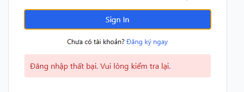

Đã được người dùng duyệt để tạo Issue từ mục 10 trong `04-bug-reports.md`.

- **Checklist ID:** GUI-029, GUI-030
- **Màn hình / URL SUT:** `http://127.0.0.1:5173/login`
- **Severity:** Trung bình — FR-22 yêu cầu thông báo lỗi xuất hiện phía trên nút gửi.

### Environment
**Môi trường ghi nhận quan sát trong checklist:** trình duyệt tích hợp VS Code (Electron 43.8.3; Chrome 150.0.7871.250), Windows NT 10.0, khung nhìn 1281 × 676. Checklist ghi khoảng thời gian thực thi là 2026-11-09 10:21–10:35 +07, không ghi thời điểm riêng cho từng mục. GUI-044 và GUI-059 có thêm ảnh mới do người dùng cung cấp; không chạy lại kiểm thử khi cập nhật báo cáo.

### Preconditions
Mở `/login`.

### Steps
1. Gửi email sai định dạng cùng mật khẩu thử nghiệm không khớp.
2. Gửi thông tin đăng nhập thử nghiệm không hợp lệ.
3. Quan sát vị trí thông báo lỗi Đăng nhập so với nút gửi.

### Expected
Thông báo xác thực email và lỗi đăng nhập xuất hiện phía trên nút gửi, dễ đọc.

### Actual
Email sai định dạng tạo phản hồi xác thực chung bên dưới nút “Sign In”; thông báo đăng nhập thất bại cũng xuất hiện bên dưới nút đó.

### Reproducibility / Giới hạn xác minh
Không kiểm tra lại trong giai đoạn báo cáo; xem bằng chứng thực thi gốc và bản crop bảo vệ dữ liệu.

### Notes
Kết quả thực tế của GUI-029 dựa trên việc gửi địa chỉ sai định dạng và nhận lỗi đăng nhập chung; báo cáo không khẳng định đã kiểm tra cơ chế xác thực email gốc của trình duyệt.

### Screenshots
[Ảnh crop bảo vệ dữ liệu của GUI-030](https://github.com/vinhuytran0810-cell/HW03-GUI-Usability/blob/7fe3c58385a9d30107f323e39a2a0d67e4b6a0ba/evidence/gui/report-redacted/GUI-030-login-error-feedback-redacted.png?raw=true). Ảnh gốc được giữ nguyên; bản crop đã loại thông tin đăng nhập thử nghiệm đã nhập.

[Ảnh crop bảo vệ dữ liệu của GUI-030 — mở screenshot](https://github.com/vinhuytran0810-cell/HW03-GUI-Usability/blob/7fe3c58385a9d30107f323e39a2a0d67e4b6a0ba/evidence/gui/report-redacted/GUI-030-login-error-feedback-redacted.png?raw=true)

<!-- approved-gui-report:10; checklist:GUI-029, GUI-030 -->
