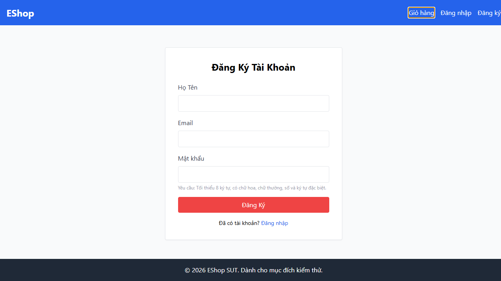

Đã được người dùng duyệt để tạo Issue từ mục 11 trong `04-bug-reports.md`.

- **Checklist ID:** GUI-021, GUI-035
- **Màn hình / URL SUT:** `http://127.0.0.1:5173/register`, `/login`
- **Severity:** Thấp — không thể nhận biết trực quan trang hiện tại trên thanh điều hướng chung, trái với FR-23.

### Environment
**Môi trường ghi nhận quan sát trong checklist:** trình duyệt tích hợp VS Code (Electron 43.8.3; Chrome 150.0.7871.250), Windows NT 10.0, khung nhìn 1281 × 676. Checklist ghi khoảng thời gian thực thi là 2026-11-09 10:21–10:35 +07, không ghi thời điểm riêng cho từng mục. GUI-044 và GUI-059 có thêm ảnh mới do người dùng cung cấp; không chạy lại kiểm thử khi cập nhật báo cáo.

### Preconditions
Mở riêng từng màn hình Đăng ký và Đăng nhập.

### Steps
1. Kiểm tra thanh điều hướng chung trên từng màn hình.
2. Xác định xem trang hiện tại có được phân biệt trực quan hay không.

### Expected
Mục điều hướng tương ứng với trang hiện tại được làm nổi bật trực quan.

### Actual
Các liên kết Đăng ký và Đăng nhập có cùng kiểu hiển thị; checklist không ghi nhận kiểu đang chọn hoặc trạng thái `aria-current`.

### Reproducibility / Giới hạn xác minh
Không kiểm tra lại trong giai đoạn báo cáo; xem bằng chứng thực thi được liên kết.

### Notes
Hồ sơ được ghi nhận là có làm nổi bật nên không nằm trong phát hiện này.

### Screenshots
[GUI-021](https://github.com/vinhuytran0810-cell/HW03-GUI-Usability/blob/7fe3c58385a9d30107f323e39a2a0d67e4b6a0ba/evidence/gui/GUI-021-registration-active-nav.png?raw=true), [GUI-035](https://github.com/vinhuytran0810-cell/HW03-GUI-Usability/blob/7fe3c58385a9d30107f323e39a2a0d67e4b6a0ba/evidence/gui/GUI-035-login-active-nav.png?raw=true)

[GUI-021 — mở screenshot](https://github.com/vinhuytran0810-cell/HW03-GUI-Usability/blob/7fe3c58385a9d30107f323e39a2a0d67e4b6a0ba/evidence/gui/GUI-021-registration-active-nav.png?raw=true)

[GUI-035 — mở screenshot](https://github.com/vinhuytran0810-cell/HW03-GUI-Usability/blob/7fe3c58385a9d30107f323e39a2a0d67e4b6a0ba/evidence/gui/GUI-035-login-active-nav.png?raw=true)

<!-- approved-gui-report:11; checklist:GUI-021, GUI-035 -->
