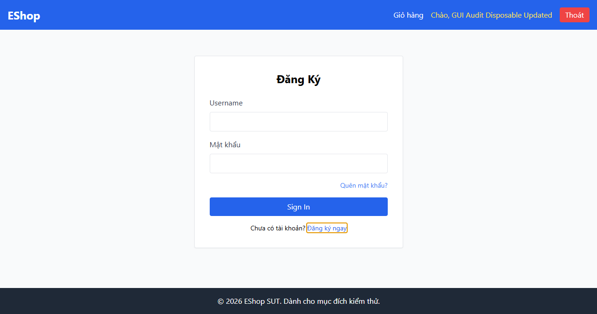
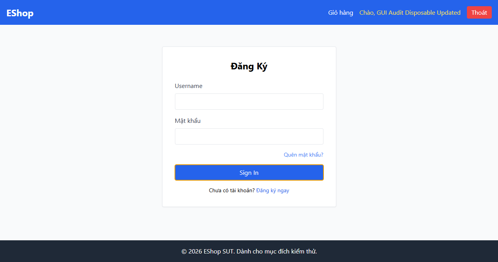

Đã được người dùng duyệt để tạo Issue từ mục 12 trong `04-bug-reports.md`.

- **Checklist ID:** GUI-032
- **Màn hình / URL SUT:** `http://127.0.0.1:5173/login`
- **Severity:** Trung bình — thứ tự focus bằng bàn phím quan sát được khác với thứ tự trực quan từ trên xuống dưới đã quy định.

### Environment
**Môi trường ghi nhận quan sát trong checklist:** trình duyệt tích hợp VS Code (Electron 43.8.3; Chrome 150.0.7871.250), Windows NT 10.0, khung nhìn 1281 × 676. Checklist ghi khoảng thời gian thực thi là 2026-11-09 10:21–10:35 +07, không ghi thời điểm riêng cho từng mục. GUI-044 và GUI-059 có thêm ảnh mới do người dùng cung cấp; không chạy lại kiểm thử khi cập nhật báo cáo.

### Preconditions
Mở `/login`; có thể tương tác bằng bàn phím.

### Steps
1. Đưa focus vào trường Email.
2. Nhấn Tab liên tục và ghi lại các điều khiển lần lượt nhận focus.

### Expected
Focus di chuyển theo thứ tự trực quan từ trên xuống dưới đã quy định.

### Actual
Thứ tự quan sát được sau trường Email là Mật khẩu, Quên mật khẩu, liên kết Đăng ký, rồi nút “Sign In”. Liên kết Đăng ký nhận focus trước nút gửi nằm phía trên nó theo bố cục trực quan.

### Reproducibility / Giới hạn xác minh
Không kiểm tra lại trong giai đoạn báo cáo; xem bằng chứng thực thi được liên kết.

### Notes
Phát hiện này chỉ phản ánh thứ tự focus Đăng nhập đã ghi nhận.

### Screenshots
[Focus tại liên kết Đăng ký](https://github.com/vinhuytran0810-cell/HW03-GUI-Usability/blob/7fe3c58385a9d30107f323e39a2a0d67e4b6a0ba/evidence/gui/GUI-032-login-tab-order-register-link.png?raw=true), [focus tại nút gửi](https://github.com/vinhuytran0810-cell/HW03-GUI-Usability/blob/7fe3c58385a9d30107f323e39a2a0d67e4b6a0ba/evidence/gui/GUI-032-login-tab-order-submit.png?raw=true)

[Focus tại liên kết Đăng ký — mở screenshot](https://github.com/vinhuytran0810-cell/HW03-GUI-Usability/blob/7fe3c58385a9d30107f323e39a2a0d67e4b6a0ba/evidence/gui/GUI-032-login-tab-order-register-link.png?raw=true)

[focus tại nút gửi — mở screenshot](https://github.com/vinhuytran0810-cell/HW03-GUI-Usability/blob/7fe3c58385a9d30107f323e39a2a0d67e4b6a0ba/evidence/gui/GUI-032-login-tab-order-submit.png?raw=true)

<!-- approved-gui-report:12; checklist:GUI-032 -->
