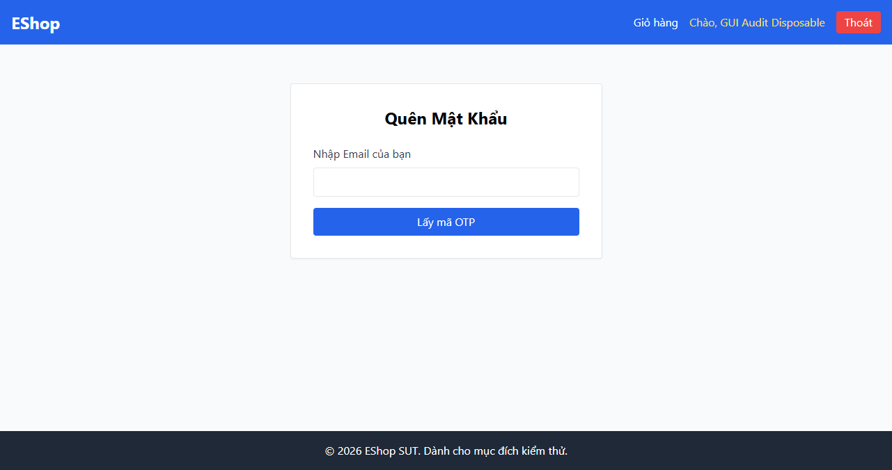

Đã được người dùng duyệt để tạo Issue từ mục 13 trong `04-bug-reports.md`.

- **Checklist ID:** GUI-042
- **Màn hình / URL SUT:** `http://127.0.0.1:5173/forgot-password`
- **Severity:** Trung bình — FR-03 yêu cầu có cách quay lại Đăng nhập; thiếu điều khiển này khiến người dùng không thể quay lại từ màn hình khôi phục ban đầu.

### Environment
**Môi trường ghi nhận quan sát trong checklist:** trình duyệt tích hợp VS Code (Electron 43.8.3; Chrome 150.0.7871.250), Windows NT 10.0, khung nhìn 1281 × 676. Checklist ghi khoảng thời gian thực thi là 2026-11-09 10:21–10:35 +07, không ghi thời điểm riêng cho từng mục. GUI-044 và GUI-059 có thêm ảnh mới do người dùng cung cấp; không chạy lại kiểm thử khi cập nhật báo cáo.

### Preconditions
Mở màn hình khôi phục ban đầu.

### Steps
1. Kiểm tra màn hình Quên mật khẩu ban đầu để tìm điều khiển quay lại Đăng nhập.
2. Thử kích hoạt điều khiển đó.

### Expected
Có điều khiển hiển thị để quay lại Đăng nhập.

### Actual
Không có điều khiển quay lại Đăng nhập hiển thị hoặc có thể kích hoạt.

### Reproducibility / Giới hạn xác minh
Không kiểm tra lại trong giai đoạn báo cáo; xem bằng chứng thực thi được liên kết.

### Notes
GUI-043 ở trạng thái Chưa chạy (Not Run) vì không thể kích hoạt điều khiển bị thiếu mà GUI-042 đã ghi nhận; mục này không được tính là ID Không đạt.

### Screenshots
[GUI-042](https://github.com/vinhuytran0810-cell/HW03-GUI-Usability/blob/7fe3c58385a9d30107f323e39a2a0d67e4b6a0ba/evidence/gui/GUI-042-forgot-login-return.png?raw=true)

[GUI-042 — mở screenshot](https://github.com/vinhuytran0810-cell/HW03-GUI-Usability/blob/7fe3c58385a9d30107f323e39a2a0d67e4b6a0ba/evidence/gui/GUI-042-forgot-login-return.png?raw=true)

<!-- approved-gui-report:13; checklist:GUI-042 -->
