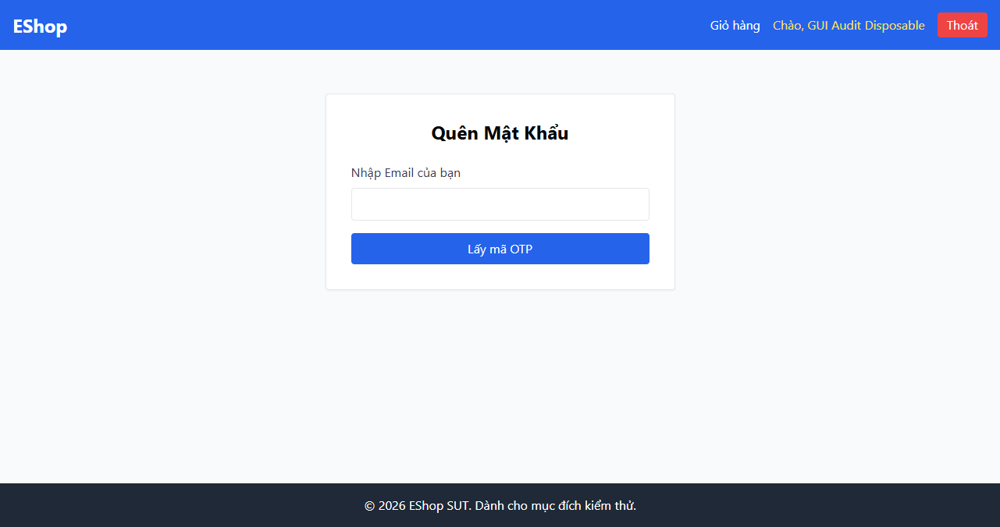
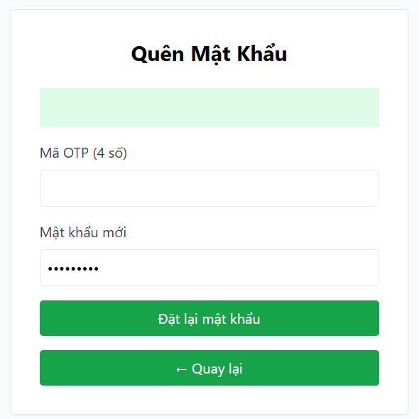
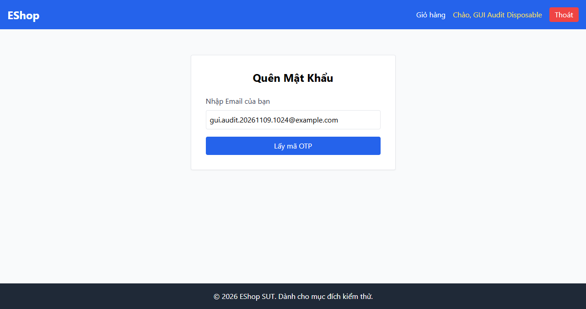

Đã được người dùng duyệt để tạo Issue từ mục 14 trong `04-bug-reports.md`.

- **Checklist ID:** GUI-038, GUI-044, GUI-050
- **Màn hình / URL SUT:** `http://127.0.0.1:5173/forgot-password`
- **Severity:** Trung bình — FR-03 và FR-22 yêu cầu có chỉ báo hiển thị cho luồng khôi phục gồm hai bước.

### Environment
**Môi trường ghi nhận quan sát trong checklist:** trình duyệt tích hợp VS Code (Electron 43.8.3; Chrome 150.0.7871.250), Windows NT 10.0, khung nhìn 1281 × 676. Checklist ghi khoảng thời gian thực thi là 2026-11-09 10:21–10:35 +07, không ghi thời điểm riêng cho từng mục. GUI-044 và GUI-059 có thêm ảnh mới do người dùng cung cấp; không chạy lại kiểm thử khi cập nhật báo cáo.

### Preconditions
Mở bước đầu của luồng khôi phục; với GUI-044 và GUI-050, quá trình kiểm thử đã đến bước hai rồi quay lại bước một.

### Steps
1. Kiểm tra màn hình khôi phục ban đầu để tìm chỉ báo bước.
2. Yêu cầu OTP và kiểm tra bước hai.
3. Quay lại bước một và kiểm tra lại.

### Expected
Bước hiện tại được nhận diện phù hợp là bước 1/2 hoặc bước 2/2.

### Actual
Checklist ghi nhận không có chỉ báo trên màn hình ban đầu, không có chỉ báo sau khi quay lại bước một và không có chỉ báo bước 2 hiển thị sau khi yêu cầu OTP.

### Reproducibility / Giới hạn xác minh
Không kiểm tra lại trong giai đoạn báo cáo; xem ảnh bước một và ảnh bước một sau khi quay lại được liên kết.

### Notes
Ảnh GUI-044 do người dùng cung cấp hỗ trợ quan sát ở bước hai. OTP đã được che trong bản crop của báo cáo; tệp bằng chứng gốc không bị thay đổi.

### Screenshots
[Bước đầu](https://github.com/vinhuytran0810-cell/HW03-GUI-Usability/blob/7fe3c58385a9d30107f323e39a2a0d67e4b6a0ba/evidence/gui/GUI-038-forgot-step-indicator.png?raw=true), [Bước hai, OTP đã che](https://github.com/vinhuytran0810-cell/HW03-GUI-Usability/blob/7fe3c58385a9d30107f323e39a2a0d67e4b6a0ba/evidence/gui/report-redacted/GUI-044-step2-redacted.png?raw=true), [Bước một sau khi quay lại](https://github.com/vinhuytran0810-cell/HW03-GUI-Usability/blob/7fe3c58385a9d30107f323e39a2a0d67e4b6a0ba/evidence/gui/GUI-050-forgot-return-step.png?raw=true). Bản crop bước hai lấy từ ảnh do người dùng cung cấp; banner OTP và giá trị OTP đã nhập đã được che.

[Bước đầu — mở screenshot](https://github.com/vinhuytran0810-cell/HW03-GUI-Usability/blob/7fe3c58385a9d30107f323e39a2a0d67e4b6a0ba/evidence/gui/GUI-038-forgot-step-indicator.png?raw=true)

[Bước hai, OTP đã che — mở screenshot](https://github.com/vinhuytran0810-cell/HW03-GUI-Usability/blob/7fe3c58385a9d30107f323e39a2a0d67e4b6a0ba/evidence/gui/report-redacted/GUI-044-step2-redacted.png?raw=true)

[Bước một sau khi quay lại — mở screenshot](https://github.com/vinhuytran0810-cell/HW03-GUI-Usability/blob/7fe3c58385a9d30107f323e39a2a0d67e4b6a0ba/evidence/gui/GUI-050-forgot-return-step.png?raw=true)

<!-- approved-gui-report:14; checklist:GUI-038, GUI-044, GUI-050 -->
