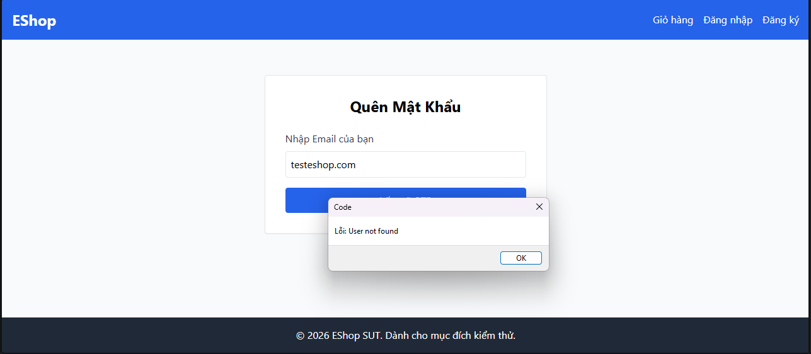

Đã được người dùng duyệt để tạo Issue từ mục 16 trong `04-bug-reports.md`.

- **Checklist ID:** GUI-041
- **Màn hình / URL SUT:** `http://127.0.0.1:5173/forgot-password`
- **Severity:** Trung bình — phản hồi được ghi nhận không khớp với thông báo lỗi định dạng email mong đợi phía trên nút gửi.

### Environment
**Môi trường ghi nhận quan sát trong checklist:** trình duyệt tích hợp VS Code (Electron 43.8.3; Chrome 150.0.7871.250), Windows NT 10.0, khung nhìn 1281 × 676. Checklist ghi khoảng thời gian thực thi là 2026-11-09 10:21–10:35 +07, không ghi thời điểm riêng cho từng mục. GUI-044 và GUI-059 có thêm ảnh mới do người dùng cung cấp; không chạy lại kiểm thử khi cập nhật báo cáo.

### Preconditions
Mở màn hình Quên mật khẩu ban đầu.

### Steps
1. Nhập địa chỉ email sai định dạng.
2. Gửi yêu cầu OTP.
3. Quan sát cách phản hồi được hiển thị.

### Expected
Thông báo xác thực định dạng email hiển thị phía trên nút gửi.

### Actual
Hộp thoại trình duyệt hiển thị “Lỗi: User not found”; không có thông báo lỗi định dạng email nội tuyến phía trên nút.

### Reproducibility / Giới hạn xác minh
Không kiểm tra lại trong giai đoạn báo cáo; xem ảnh thực thi được liên kết.

### Notes
Báo cáo ghi nhận giao diện phản hồi đã quan sát, không đánh giá cơ chế tra cứu tài khoản phía sau.

### Screenshots
[GUI-041](https://github.com/vinhuytran0810-cell/HW03-GUI-Usability/blob/7fe3c58385a9d30107f323e39a2a0d67e4b6a0ba/evidence/gui/GUI-041.png?raw=true)

[GUI-041 — mở screenshot](https://github.com/vinhuytran0810-cell/HW03-GUI-Usability/blob/7fe3c58385a9d30107f323e39a2a0d67e4b6a0ba/evidence/gui/GUI-041.png?raw=true)

<!-- approved-gui-report:16; checklist:GUI-041 -->
