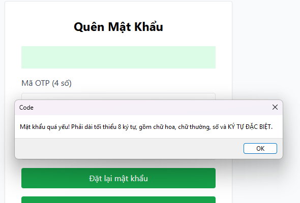

Đã được người dùng duyệt để tạo Issue từ mục 17 trong `04-bug-reports.md`.

- **Checklist ID:** GUI-049
- **Màn hình / URL SUT:** `http://127.0.0.1:5173/forgot-password` (bước đặt lại mật khẩu)
- **Severity:** Trung bình — phản hồi quan sát được là hộp thoại trình duyệt thay vì thông báo nội tuyến phía trên nút gửi.

### Environment
**Môi trường ghi nhận quan sát trong checklist:** trình duyệt tích hợp VS Code (Electron 43.8.3; Chrome 150.0.7871.250), Windows NT 10.0, khung nhìn 1281 × 676. Checklist ghi khoảng thời gian thực thi là 2026-11-09 10:21–10:35 +07, không ghi thời điểm riêng cho từng mục. GUI-044 và GUI-059 có thêm ảnh mới do người dùng cung cấp; không chạy lại kiểm thử khi cập nhật báo cáo.

### Preconditions
Luồng khôi phục đã đến bước hai.

### Steps
1. Nhập OTP sai và mật khẩu không đáp ứng yêu cầu độ mạnh đang hiển thị.
2. Gửi biểu mẫu đặt lại mật khẩu.
3. Quan sát phản hồi nào được hiển thị.

### Expected
Thông báo xác thực hoặc phản hồi yêu cầu đặt lại hiển thị dễ đọc phía trên nút gửi.

### Actual
Người dùng xác nhận rằng sau khi gửi OTP sai cùng mật khẩu yếu, hệ thống hiển thị hộp thoại: “Mật khẩu quá yếu!”. Không nhận được hoặc xác minh phản hồi liên quan đến OTP.

### Reproducibility / Giới hạn xác minh
Hộp thoại được hỗ trợ bởi ảnh GUI-049 do người dùng cung cấp và xác nhận của người dùng. Chưa kiểm tra xem hệ thống có báo OTP sai khi dùng mật khẩu đủ mạnh hay không.

### Notes
Không xem đây là bằng chứng đã kiểm tra xác thực OTP sai. Quan sát chỉ giới hạn ở việc hiển thị cảnh báo mật khẩu yếu và chưa thể xác nhận phản hồi OTP trong lần gửi này.

### Screenshots
[Cảnh báo độ mạnh mật khẩu GUI-049, OTP đã che](https://github.com/vinhuytran0810-cell/HW03-GUI-Usability/blob/7fe3c58385a9d30107f323e39a2a0d67e4b6a0ba/evidence/gui/report-redacted/GUI-049-password-alert-redacted.png?raw=true). Ảnh chụp gốc được giữ nguyên.

[Cảnh báo độ mạnh mật khẩu GUI-049, OTP đã che — mở screenshot](https://github.com/vinhuytran0810-cell/HW03-GUI-Usability/blob/7fe3c58385a9d30107f323e39a2a0d67e4b6a0ba/evidence/gui/report-redacted/GUI-049-password-alert-redacted.png?raw=true)

<!-- approved-gui-report:17; checklist:GUI-049 -->
