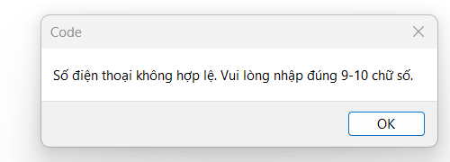

Đã được người dùng duyệt để tạo Issue từ mục 18 trong `04-bug-reports.md`.

- **Checklist ID:** GUI-059
- **Màn hình / URL SUT:** `http://127.0.0.1:5173/profile`
- **Severity:** Trung bình — FR-22 yêu cầu thông báo xác thực hiển thị phía trên thao tác lưu.

### Environment
**Môi trường ghi nhận quan sát trong checklist:** trình duyệt tích hợp VS Code (Electron 43.8.3; Chrome 150.0.7871.250), Windows NT 10.0, khung nhìn 1281 × 676. Checklist ghi khoảng thời gian thực thi là 2026-11-09 10:21–10:35 +07, không ghi thời điểm riêng cho từng mục. GUI-044 và GUI-059 có thêm ảnh mới do người dùng cung cấp; không chạy lại kiểm thử khi cập nhật báo cáo.

### Preconditions
Người dùng thử nghiệm đã đăng nhập và đang ở `/profile`.

### Steps
1. Nhập số điện thoại được checklist ghi nhận là không hợp lệ.
2. Gửi biểu mẫu Hồ sơ.
3. Quan sát cách phản hồi được hiển thị.

### Expected
Thông báo xác thực số điện thoại dễ đọc và hiển thị phía trên nút lưu.

### Actual
Ảnh do người dùng cung cấp cho thấy hộp thoại trình duyệt ghi “Số điện thoại không hợp lệ. Vui lòng nhập đúng 9-10 chữ số.” thay vì thông báo nội tuyến phía trên nút lưu.

### Reproducibility / Giới hạn xác minh
Ảnh ghi lại hộp thoại này. Bản thân quy tắc xác thực số điện thoại không được kiểm tra trong lần cập nhật báo cáo.

### Notes
Nội dung cảnh báo đề cập 9–10 chữ số, trong khi FR-04 quy định 10–11 chữ số bắt đầu bằng 0. Báo cáo không đánh giá quy tắc nghiệp vụ số điện thoại; phát hiện này chỉ liên quan đến cách hiển thị phản hồi.

### Screenshots
[Ảnh crop cảnh báo xác thực số điện thoại GUI-059](https://github.com/vinhuytran0810-cell/HW03-GUI-Usability/blob/7fe3c58385a9d30107f323e39a2a0d67e4b6a0ba/evidence/gui/report-redacted/GUI-059-phone-alert-crop.png?raw=true), được crop từ ảnh người dùng cung cấp để loại dữ liệu hồ sơ. Ảnh gốc được giữ nguyên.

[Ảnh crop cảnh báo xác thực số điện thoại GUI-059 — mở screenshot](https://github.com/vinhuytran0810-cell/HW03-GUI-Usability/blob/7fe3c58385a9d30107f323e39a2a0d67e4b6a0ba/evidence/gui/report-redacted/GUI-059-phone-alert-crop.png?raw=true)

<!-- approved-gui-report:18; checklist:GUI-059 -->
