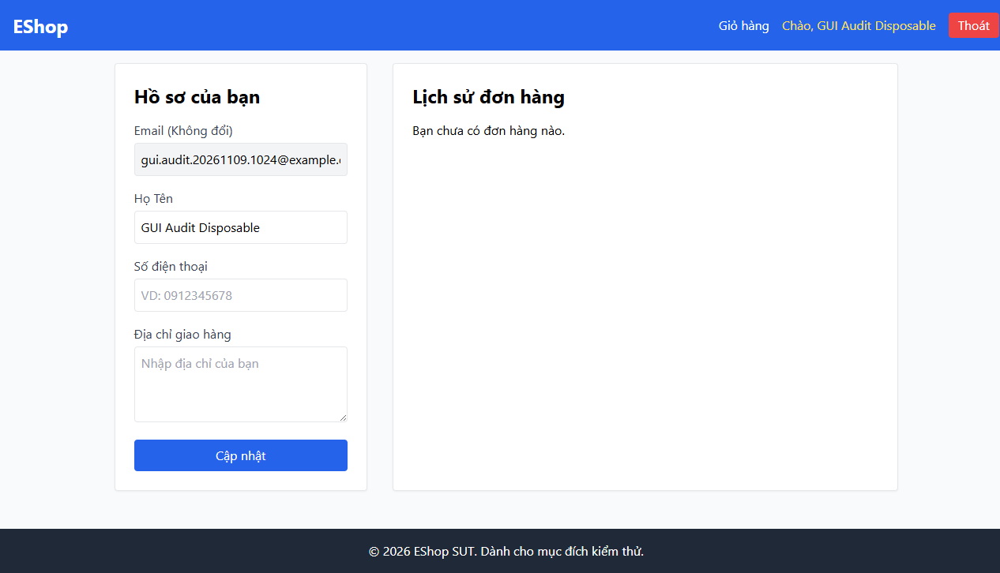

Đã được người dùng duyệt để tạo Issue từ mục 19 trong `04-bug-reports.md`.

- **Checklist ID:** GUI-063
- **Màn hình / URL SUT:** `http://127.0.0.1:5173/profile` (đã đăng nhập)
- **Severity:** Thấp — nhãn thao tác không khớp với FR-23.

### Environment
**Môi trường ghi nhận quan sát trong checklist:** trình duyệt tích hợp VS Code (Electron 43.8.3; Chrome 150.0.7871.250), Windows NT 10.0, khung nhìn 1281 × 676. Checklist ghi khoảng thời gian thực thi là 2026-11-09 10:21–10:35 +07, không ghi thời điểm riêng cho từng mục. GUI-044 và GUI-059 có thêm ảnh mới do người dùng cung cấp; không chạy lại kiểm thử khi cập nhật báo cáo.

### Preconditions
Người dùng đã đăng nhập đang ở `/profile`.

### Steps
1. Kiểm tra thanh điều hướng khi đã đăng nhập.
2. Đọc nhãn thao tác đăng xuất.

### Expected
Thao tác có nhãn “Đăng xuất”.

### Actual
Thao tác có nhãn “Thoát”.

### Reproducibility / Giới hạn xác minh
Không kiểm tra lại trong giai đoạn báo cáo; xem bằng chứng thực thi được liên kết.

### Notes
Phát hiện này chỉ liên quan đến nhãn thao tác hiển thị.

### Screenshots
[GUI-063](https://github.com/vinhuytran0810-cell/HW03-GUI-Usability/blob/7fe3c58385a9d30107f323e39a2a0d67e4b6a0ba/evidence/gui/GUI-063-profile-logout-label.png?raw=true)

[GUI-063 — mở screenshot](https://github.com/vinhuytran0810-cell/HW03-GUI-Usability/blob/7fe3c58385a9d30107f323e39a2a0d67e4b6a0ba/evidence/gui/GUI-063-profile-logout-label.png?raw=true)

<!-- approved-gui-report:19; checklist:GUI-063 -->
