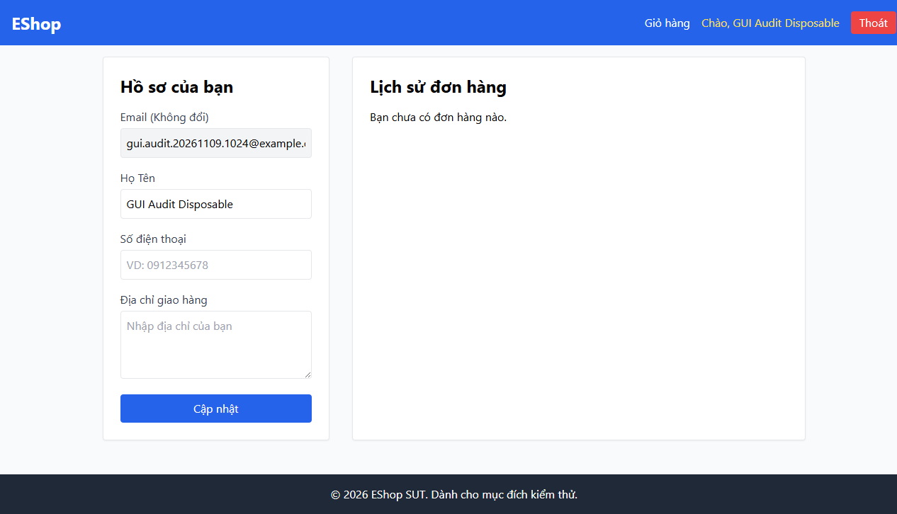

Đã được người dùng duyệt để tạo Issue từ mục 20 trong `04-bug-reports.md`.

- **Checklist ID:** GUI-064
- **Màn hình / URL SUT:** `http://127.0.0.1:5173/profile` (tài khoản chưa có đơn hàng)
- **Severity:** Thấp — FR-24 yêu cầu trạng thái trống có biểu tượng hoặc hình minh họa.

### Environment
**Môi trường ghi nhận quan sát trong checklist:** trình duyệt tích hợp VS Code (Electron 43.8.3; Chrome 150.0.7871.250), Windows NT 10.0, khung nhìn 1281 × 676. Checklist ghi khoảng thời gian thực thi là 2026-11-09 10:21–10:35 +07, không ghi thời điểm riêng cho từng mục. GUI-044 và GUI-059 có thêm ảnh mới do người dùng cung cấp; không chạy lại kiểm thử khi cập nhật báo cáo.

### Preconditions
Người dùng thử nghiệm đã đăng nhập, không có đơn hàng và đang ở `/profile`.

### Steps
1. Kiểm tra trạng thái lịch sử đơn hàng trống.

### Expected
Trạng thái trống có thông báo cùng biểu tượng hoặc hình minh họa.

### Actual
Thông báo chưa có đơn hàng hiển thị, nhưng checklist ghi nhận không có hình ảnh hoặc minh họa SVG.

### Reproducibility / Giới hạn xác minh
Không kiểm tra lại trong giai đoạn báo cáo; xem bằng chứng thực thi được liên kết.

### Notes
Phát hiện này chỉ liên quan đến hình thức trạng thái trống; không kiểm tra hành vi đơn hàng.

### Screenshots
[GUI-064](https://github.com/vinhuytran0810-cell/HW03-GUI-Usability/blob/7fe3c58385a9d30107f323e39a2a0d67e4b6a0ba/evidence/gui/GUI-064-profile-empty-orders.png?raw=true)

[GUI-064 — mở screenshot](https://github.com/vinhuytran0810-cell/HW03-GUI-Usability/blob/7fe3c58385a9d30107f323e39a2a0d67e4b6a0ba/evidence/gui/GUI-064-profile-empty-orders.png?raw=true)

<!-- approved-gui-report:20; checklist:GUI-064 -->
